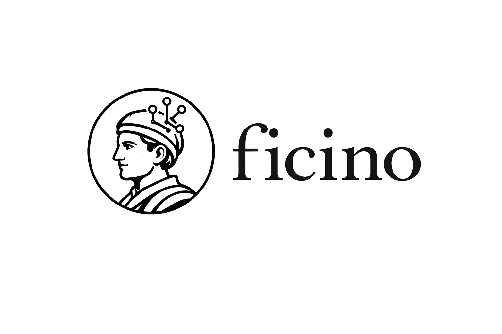

<p align="center">
  <picture>
    <source media="(prefers-color-scheme: dark)" srcset="frontend/public/ficino-logo-dark.png" />
    <source media="(prefers-color-scheme: light)" srcset="frontend/public/ficino-logo.png" />
    
  </picture>
</p>

<p align="center">
  
</p>

<p align="center">
  <strong>AI-powered academic discourse engine</strong><br/>
  Transform dense research papers into a simulated social media feed where AI personas debate the findings.<br/><br/>
  <a href="https://docs.ficino.ai">Docs</a> · <a href="https://github.com/umzcio/ficino/blob/main/FEATURES.md">Roadmap</a>
</p>

<p align="center">
  
  
  
  
</p>

---

## Origin

Ficino is named after **Marsilio Ficino** (1433-1499), the Florentine Renaissance scholar who ran the Platonic Academy and spent his life translating, synthesizing, and animating Greek texts into active Latin discourse. He didn't just read sources: he made them argue with each other across centuries.

That's exactly what this app does.

Ficino takes academic papers (dense, unreadable, inaccessible) and transforms them into a simulated social media feed where AI personas debate the findings, cross-reference competing papers, cite figures, and surface the fault lines in the literature. Built specifically for ADHD-native learning: scroll-first, controversy-first, one finding per post.

**The core insight:** you don't need to *read* papers to *absorb* a field. You need repeated, multi-angle exposure to the same claims through different lenses. That's what Ficino does, disguised as doomscrolling.

---

## How It Works

```
Upload PDFs --> Ingest & Chunk --> AI Personas Debate --> You Learn by Scrolling
```

1. **Upload papers**: drag-drop PDFs into your corpus
2. **Automatic ingestion**: extracts text (MuPDF, or a vision-model fallback for tricky PDFs), detects sections, chunks intelligently, optionally generates a per-chunk contextual prefix, then embeds. Figures are detected per page by a vision model (local Ollama or Claude) — only *scientific* figures (charts, diagrams, photographs) are kept, each tagged with a caption, figure number, data claim, and type
3. **Generate feed**: six AI personas retrieve relevant chunks via hybrid search (vector + keyword, with an optional hosted reranker as stage 3), and generate a Twitter/X-style discourse feed. Figures are only offered to personas whose `allowed_figure_types` cover the figure's type — so Methods Skeptic never critiques a UI icon
4. **Cross-paper RAG**: personas argue *across* papers, detecting contradictions and agreements
5. **Interact**: reply to personas, bookmark posts, explore paper summaries, trace claims back to source chunks

---

## Personas

Six feed personas + The Archivist (reply-only), each grounded in RAG-retrieved paper content. Persona prompts are engineered from research on science communication, the replication crisis, and academic social media discourse -- each persona's "moves" map to documented behaviors from credible practitioners in their archetype (Gelman, Mollick, Bik, Veritasium, etc.).

| Handle | Name | Style |
|--------|------|-------|
| `@skeptical_methods` | **Methods Skeptic** | Interrogates study design, sample size, operationalization |
| `@ai_breakthroughs` | **AI Breakthroughs** | Hype-forward, leads with headline findings |
| `@real_world_ml` | **Practitioner Pat** | Asks "does this work outside R1 institutions?" |
| `@stats_nerd` | **Stats Nerd** | Threads out methodology, flags construct validity |
| `@phd_suffering` | **PhD Candidate** | Relatable confusion, asks the questions readers are afraid to ask |
| `@big_if_true` | **The Amplifier** | Narrativist — names the mechanism, imports frameworks, lands a reframe. Think Veritasium or Tim Urban on Twitter |
| `@the_archivist` | **The Archivist** | Neutral research assistant — answers your questions with citations, no persona voice |

Each persona can be enabled/disabled and configured via Settings. You can reply to any persona and have a multi-turn conversation grounded in your paper content. The Archivist responds to your own posts in the feed via the compose box.

---

## Features

### Core Feed
- **Twitter/X clone UI**: three-column desktop layout, mobile-responsive with bottom nav
- **Five post types**: standalone posts, threads (expandable), quote-tweets, replies, figure posts
- **Feed tabs**: For You / Debates / Methods / Findings (client-side filtering by post category)
- **Feed history**: browse and reload past generated feeds
- **Source reveal**: tap to see the exact paper chunks each post is grounded in

### Paper Intelligence (DMs)
- **Paper summaries**: tap a paper in Messages to get a structured TL;DR + 7-part breakdown
- **Group chats**: select multiple papers for cross-corpus synthesis (agreements, contradictions, gaps)
- **Cached**: summaries generate once, load instantly on return

### Ask Your Corpus
- **Compose box**: type a question at the top of the feed — your post appears in the timeline
- **The Archivist**: neutral 6th persona that responds to your posts with RAG-grounded answers, hybrid retrieval (top 15 chunks), citation-rich
- **User profile**: view all your posts and Archivist replies on your profile page
- **Source transparency**: every Archivist reply includes expandable source chunks with relevance scores

### Organization
- **Workspaces**: named research contexts (dissertation, conference paper, grant proposal)
- **#Tags**: auto-generated on upload + manual tagging, with corpus-scoped feed generation
- **"What's happening" corpus panel**: papers as headlines with TL;DR teasers, click to expand
- **Auto-generate on upload**: optional automatic feed generation when a paper finishes processing
- **Desktop dropdown + mobile long-press** switcher for workspace management

### Interaction
- **Reply to personas**: multi-turn threaded conversations in Twitter/X reply style. Optimistic send with typing indicator
- **@Mention personas**: type `@` in a reply to summon another persona. Autocomplete dropdown, targeted response in character
- **Conductor mode**: retweet (↻) button on any post or reply message opens a persona picker — route any message to any persona for their take. Orchestrate multi-persona debates without typing
- **Organic interjections**: other personas jump into your reply threads when the topic touches their expertise
- **Persona profiles**: click any persona name to view their profile with avatar, bio, and three tabs — **Posts** (their feed posts), **Replies** (every interjection they made into other threads with parent-post context), **Messages** (private DM)
- **Get their take**: on any persona's profile, click "Get their take" to generate 3 new posts from that persona on your current corpus — appended to the active feed
- **Persona DMs**: message any persona directly — they respond in character, grounded in your corpus
- **Post detail view**: click any post to see full thread context — parent posts, quoted originals, downstream responses
- **Annotations**: private notes on any post via three-dots menu, visible in feed and bookmarks
- **Cite this**: one-click APA/MLA citation generation from the three-dots menu, copied to clipboard
- **Bookmarks**: snapshot-based, survives feed regeneration
- **Append mode**: "Generate more posts" adds to the current feed instead of replacing it
- **Figure lightbox**: extracted figures rendered inline with expand-on-click
- **Per-reply three-dots menu**: Copy text / Delete message on individual replies and interjections inside a thread
- **Nested quote cards**: quote-tweet posts render the quoted persona as a Twitter-style nested card (avatar + name + @handle + content) inside the quoter's post

### Intelligence Layer
- **Contradiction alerts**: notified when a new paper contradicts existing corpus
- **Disagreement spikes**: flagged when feed generation produces unusual debate volume
- **Reading gap nudges**: prompted to go deeper on papers you've debated but not summarized
- **Stale corpus nudges**: reminded about papers sitting for 7+ days without any generated discourse

### Reading Lists
- **AI-ordered syllabi**: create a reading list — The Archivist proposes an optimal reading order with rationale based on citation chains and conceptual dependencies
- **Progressive chapters**: each paper is a chapter. Generate chapters sequentially — later chapters reference earlier papers, building cumulative discourse
- **Interactive reordering**: AI proposes, you adjust. Drag to customize the sequence

### Listen Mode (Audio)
- **Feed audio**: one-click ElevenLabs TTS renders every post as its own mp3, each persona voiced in a distinct preset that matches their character (Methods Skeptic sounds different from The Amplifier). Track-list UI with skip/prev, click any post to jump
- **Podcast mode**: NotebookLM-style two-host dialogue generated in a single ElevenLabs v3 Dialogue Mode call — one continuous audio file with natural pacing, short reactions, and cross-speaker prosody. Grounded in the same retrieved chunks the feed was built on; hosts paraphrase and name-check the personas without using their voices
- **Scrolling transcript**: podcast mode renders every turn as a two-color transcript (Host A gold, Host B teal) so you can read along
- **Lazy & idempotent**: audio costs ElevenLabs characters, so nothing synthesizes until you press play. Re-clicks return the cached episode instead of re-spending credits
- **Requires `ELEVENLABS_API_KEY`** (feed audio works on any tier; podcast mode needs v3 access)

### Configuration
- **LLM provider switching**: toggle between Ollama (local, free) and Claude; embeddings from Ollama, Voyage or OpenAI
- **Model selection**: pick from installed Ollama models via dropdown
- **Persona controls**: enable/disable personas, adjust temperature, tune post type weights — personas stored in DB, zero-code to add new ones
- **Paper processing**: extraction mode (auto/MuPDF text/vision), chunk size, display options
- **Light/dark mode**: instant theme switching with font size and post spacing controls

### Authentication
- **Two providers**: `AUTH_PROVIDER=none` (the default: a single owner, no login) or `basic` (email/password accounts)
- **Basic auth**: bcrypt password hashes, sessions stored in Postgres (HTTP-only cookie, 7-day sliding expiry); the first account may always register, later ones only with `ALLOW_REGISTRATION=true`
- **CSRF**: double-submit cookie on every state-changing request except login and registration; rejections are logged (`csrf_rejected`)
- **Rate limits**: per-user daily budgets kept in Postgres under `basic` (uploads, generations, posts, summaries, replies, DMs, audio)

### PWA + Offline Mode
- **Installable**: add to home screen on iOS/Android, standalone fullscreen app — no App Store
- **Service worker**: Workbox precaches all static assets, runtime-caches figure images and Google Fonts
- **IndexedDB offline data**: all hooks write through to IndexedDB on fetch, fall back to cache when offline
- **Download workspace**: one-click pre-cache of an entire workspace (feeds, papers, summaries, figures) for airplane-mode reading
- **Sync indicator**: per-workspace "synced Xm ago" shown in Settings → Storage; amber warning when stale (>24h)

### Mobile
- **Gesture-first**: swipe between feed tabs, pull-to-refresh, edge swipe-back on detail views (`@use-gesture/react` with axis-lock so horizontal swipes never fight vertical scroll)
- **Swipe-to-act on posts**: swipe-left reveals Like + Bookmark; swipe-right reveals Reply — same pattern as iOS Mail
- **Safe-area aware**: bottom nav clears the iPhone home indicator, headers clear the notch (`env(safe-area-inset-*)` + `viewport-fit=cover`)
- **Touch targets**: every action icon has a ~44×44 px hit zone without visual bloat
- **Keyboard-aware compose**: active input scrolls into view when the iOS keyboard opens (`visualViewport` API)
- **Haptics**: short vibration on like / bookmark / swipe-commit where supported (Android Chrome; silent on iOS Safari)
- **Responsive primitives**: dropdowns clamp to `calc(100vw - 2rem)`; drawer fits the smallest phones

---

## Tech Stack

| Layer | Technology |
|-------|-----------|
| **Frontend** | React + Vite + TypeScript + TailwindCSS v4 + PWA (Workbox + IndexedDB) + `@use-gesture/react`, served by nginx |
| **Backend API** | Node.js + TypeScript (strict ESM) + Hono, raw SQL with postgres.js, zod validation |
| **Worker** | The same server image running pg-boss queues: ingestion, feed generation, summaries, alerts, audio, and the daily crons |
| **Database** | PostgreSQL 18 + pgvector: data, job queues (pg-boss), sessions and rate limits all live in Postgres |
| **Auth** | `none` (single owner, no login) or `basic` (email/password, bcrypt, sessions in Postgres) |
| **LLM** | Ollama (local) or Anthropic Claude; env-driven defaults, per-user overrides in Settings |
| **Embeddings** | Ollama (`qwen3-embedding`, the default), Voyage, or OpenAI, all at 1024 dimensions |
| **PDF Processing** | MuPDF (WASM) text extraction with a vision-model fallback; figures found by a vision model (Ollama or Claude) |
| **Object Storage** | Local disk volumes, served through signed URLs (figures, feed audio, podcasts) |
| **Audio (optional)** | ElevenLabs: turbo v2.5 for per-post feed TTS, v3 Dialogue Mode for NotebookLM-style podcast episodes |
| **Deployment** | Docker Compose (self-host), on loopback or as its own tailnet node |

---

## Architecture

```
                    +------------------+
                    |     Browser      |
                    |  React + Vite    |
                    +--------+---------+
                             |
                    +--------+---------+
                    |  web (nginx)     |
                    |  /ficino/  SPA   |
                    |  /ficino/api/ ---+------+
                    +------------------+      |
                                              v
     +-------------------+         +-------------------+
     |  worker (Node)    |         |   api (Node/Hono) |
     |  pg-boss queues:  |         |   /papers /feed   |
     |  ingestion, feed, |         |   /messages       |
     |  summaries, audio,|         |   /replies /media |
     |  alerts, crons    |         |   ...             |
     +---------+---------+         +---------+---------+
               |                             |
               +--------------+--------------+
               |              |              |
     +---------+---------+    |    +---------+---------+
     |  PostgreSQL 18    |    |    |  Volumes          |
     |  + pgvector       |    |    |  uploads, figures,|
     |  data, jobs,      |    |    |  media (shared by |
     |  sessions, limits |    |    |  api and worker)  |
     +-------------------+    |    +-------------------+
                              v
                   +----------------------+
                   |  Providers           |
                   |  Ollama / Anthropic  |
                   |  Voyage / OpenAI     |
                   |  ElevenLabs (audio)  |
                   +----------------------+
```

The api and the worker run from one image (`ficino-server:local`) and share the database, the signing key and the
storage volumes: the api writes an uploaded PDF, the worker reads it.

---

## Quick Start

Ficino is self-hosted. (The hosted service was shut down in October 2026.)

**Prerequisites:**
- Docker with Docker Compose v2
- Either an Anthropic API key *or* a local Ollama with an LLM, an embedding model and a vision model:
  ```bash
  ollama pull qwen3.8:27b
  ollama pull qwen3-embedding
  ollama pull qwen3-vl:32b   # vision fallback and figure detection
  ```

**Setup:**
```bash
git clone https://github.com/umzcio/ficino.git
cd ficino

# Configure: in postgres.env set POSTGRES_PASSWORD (Postgres reads only that file); in .env set the
# same password in DATABASE_URL, SIGNED_URL_KEY, CORS_ORIGINS, AUTH_PROVIDER and your providers.
# .env.example lists every server setting: the usual ones first, the rest commented out at their defaults.
cp postgres.env.example postgres.env && chmod 600 postgres.env
cp .env.example .env

# Reach the web service on this machine only (127.0.0.1:8080)
cp deploy/loopback/docker-compose.override.example.yml docker-compose.override.yml

docker compose up -d --build
```

Browse `http://localhost:8080/ficino/` (use `localhost`, not `127.0.0.1`: production cookies are `Secure`, and
browsers accept them over plain http on `localhost` only).

The base `docker-compose.yml` publishes no port; the override decides how the stack is reached. The alternative to
the loopback override is `deploy/tailnet/`, which runs Ficino as its own Tailscale node behind an owner-only gate.
See [deploy/README.md](deploy/README.md) for how the files layer and where secrets go.

---

## PDF Ingestion Pipeline

```
PDF Upload
    |
    v
MuPDF Text Extraction (with smart heading detection)
    |
    v
Quality Check (symbol density, word length, encoding artifacts)
    |
    +-- PASS --> continue
    |
    +-- FAIL --> Vision Fallback (page by page)
    |
    v
Metadata + Auto-tags (title, authors, year, DOI via LLM)
    |
    v
Section-Aware Chunking --> Contextual Prefixes (optional) --> Embeddings --> pgvector
    |
    v
Figure Detection (vision model, scientific figures only)
    |
    v
Contradiction Alert Check (async, against existing corpus)
```

---

## Hybrid Search

Retrieval runs in two stages inside Postgres: a pgvector (HNSW) nearest-neighbour leg and a tsvector keyword leg
each fetch a candidate pool, then the candidates are fused with a weighted score (0.7 vector + 0.3 keyword by
default; `RETRIEVAL_VECTOR_WEIGHT`, `RETRIEVAL_KEYWORD_WEIGHT`). An optional third stage reranks the pool with
Voyage or Cohere (`RERANK_PROVIDER`).

Author names, paper titles, and technical terms hit via the keyword leg. Semantic similarity handles conceptual
retrieval. Only chunks embedded with the configured embedding model are searched, so after changing the embedding
model run the re-embed (see [server/README.md](server/README.md)).

---

## Project Structure

```
ficino/
├── docker-compose.yml        # the generic stack: postgres, api, worker, web (no published ports)
├── docker-compose.e2e.yml    # the throwaway loopback stack for the Playwright gate (project ficino-e2e)
├── .env.example              # every server setting, documented (the api and worker read .env)
├── postgres.env.example      # POSTGRES_PASSWORD, the only setting the postgres service reads
├── frontend/                 # React + Vite + TypeScript (the web image: the build behind nginx)
├── server/                   # the backend: api, worker, migrations, restore and re-embed CLIs
│   ├── src/                  # api/, worker/, routes/, tasks/, feed/, ingest/, providers/, restore/, ...
│   ├── migrations/           # numbered SQL migrations (0001_baseline.sql, ...)
│   └── test/                 # vitest suite against a throwaway Postgres
├── deploy/                   # override examples (loopback, tailnet), the tailnet web nginx, deploy checks
├── tests/e2e/                # Playwright specs and the skip inventory (SKIPS.md)
└── scripts/                  # e2e-stack.sh: drives the e2e stack
```

---

## Design Decisions

**Why a Twitter/X clone?** Academic papers are impenetrable. The same attention mechanics that make Twitter addictive can make research absorbable: scroll-first, controversy-first, one finding per post. ADHD-native learning disguised as doomscrolling.

**Why six personas?** They map to real epistemic roles in academic discourse: the skeptic, the hype machine, the practitioner, the methodologist, the confused grad student, and the narrativist. Together they create multi-angle exposure to the same claims.

**Why pgvector with hybrid search?** Keeps everything in one database, one query language. At our scale (~4,000 vectors), pgvector handles this trivially. Hybrid search catches both semantic similarity and exact term matches (author names, technical vocabulary).

**Why everything in Postgres?** Jobs (pg-boss), sessions and rate limits share the one database, so the stack is four containers with no broker or cache to run, back up or keep in sync.

**Why pluggable LLM providers?** No hardcoded vendor. Env-driven defaults (`LLM_PROVIDER`, `EMBED_PROVIDER`, `VISION_PROVIDER`) let you run fully local on Ollama at zero cost, or point at Anthropic (and Voyage or OpenAI embeddings) instead. The compose defaults use Ollama.

**Why section-aware chunking?** A methods chunk retrieved alongside a findings chunk creates confused personas. Section labels mean personas can focus on their domain: methodology critiques come from methods chunks, hype posts come from findings chunks.

---

## Development

Node ≥ 22.18 on the host (the server image uses Node 24; the web image still builds on Node 20) and Docker.

```bash
# Server: typecheck, then the full suite (it starts and removes its own throwaway Postgres)
cd server && npm ci && npm run typecheck && npm test && npm run build

# Frontend
cd frontend && npm ci && npx tsc -b && npm test && npm run build

# Deploy checks (repo root): render every compose layer, run the web nginx template in throwaway containers
npm ci && npm run test:deploy

# e2e: a throwaway loopback stack (project ficino-e2e), then the Playwright gate
scripts/e2e-stack.sh up && scripts/e2e-stack.sh ci; scripts/e2e-stack.sh down
```

The full e2e suite (desktop + mobile, real local models) is `scripts/e2e-stack.sh up --ollama` followed by
`scripts/e2e-stack.sh full`; see [tests/e2e/SKIPS.md](tests/e2e/SKIPS.md). Backend details, the environment
variables, migrations, the restore runbook and the re-embed are in [server/README.md](server/README.md).
Agent-facing command reference: [AGENTS.md](AGENTS.md).

---

## Roadmap

See [FEATURES.md](FEATURES.md) for the full feature backlog, including:

- Custom personas (user-created, one INSERT to the DB)
- Export feed (markdown/PDF for dissertation use)
- Citation graph (visual map of inter-paper citations)

---

## License

[AGPL v3](LICENSE) — open source, self-host freely. If you run it as a service, you must open-source your changes.

---

<p align="center">
  <em>"I love Plato in Iamblichus, I am full of admiration for him in Plotinus, I stand in awe of him in Dionysius."</em><br/>
  <sub>-- Marsilio Ficino, Letters (Book XI, c. 1491)</sub>
</p>
